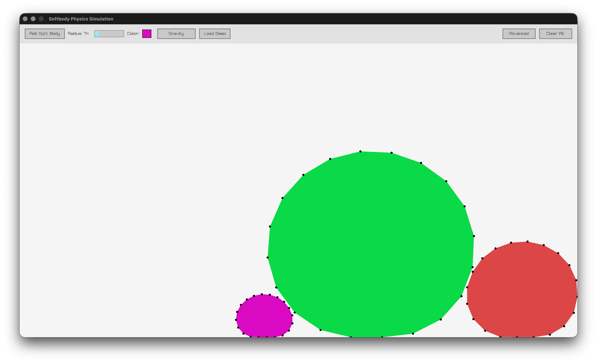
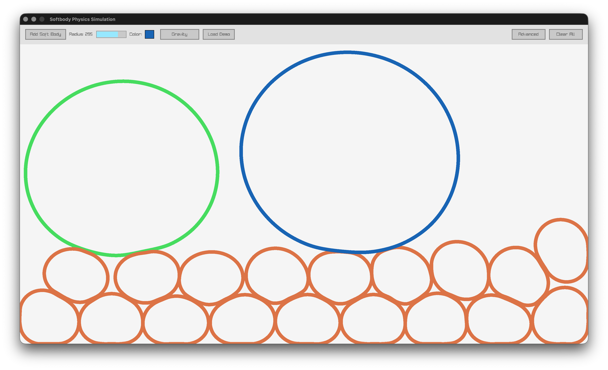

# softbody-simulation

  
  

C++/Raylib 2D Softbody Physics Simulation

## Features
* **Constraint-Based Dynamics**: Verlet Integration particle movement and raycast based collisions
* **UI Toolbar**: Add custom soft bodies, adjust gravity and other simulation settings
* **Multiple Rendering Modes**: Swap between smooth Catmull-Rom splines, filled triangle fans, and particle vertex point rendering
* **Mouse Interaction**: Click and hold on the soft bodies to drag and fling them around

## Demo

  

 

## Fan and Point Rendering

  

 

## Many Soft Bodies

  

 

